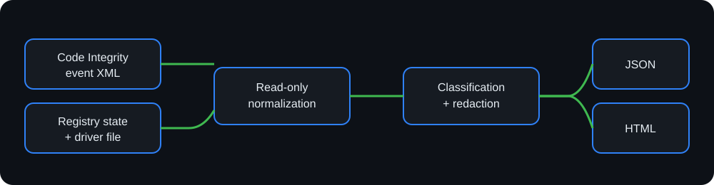
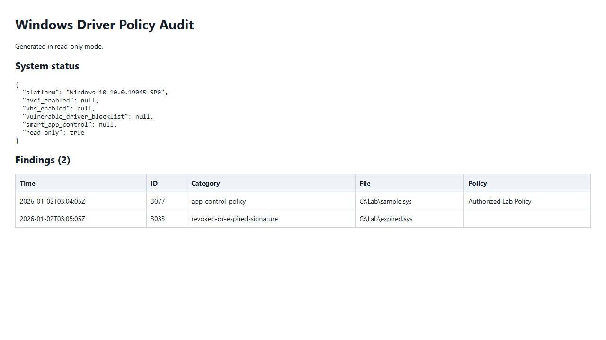

# Windows Driver Policy Auditor

[Português](#português) | [English](#english)

## Português

Ferramenta defensiva e **somente leitura** para explicar por que o Windows bloqueou um driver de kernel. Correlaciona estado de VBS/HVCI, eventos de Code Integrity, SHA-256 e assinatura Authenticode sem desligar controles de segurança.

### Recursos

- consulta configurações relevantes em modo read-only;
- coleta eventos 3004, 3023, 3033, 3076, 3077, 3082 e 3099;
- classifica assinatura inválida, revogação e App Control;
- audita `.sys` com SHA-256 e Authenticode;
- exporta JSON e HTML autocontido;
- analisa XML exportado para testes offline reproduzíveis.

```powershell
python -m pip install -e .
python -m driver_policy_auditor status
python -m driver_policy_auditor events --limit 50 --json report.json
python -m driver_policy_auditor audit-driver C:\Windows\System32\drivers\example.sys
python -m driver_policy_auditor offline tests\fixtures\codeintegrity.xml --html report.html
```

O projeto não altera registro, BCD, políticas, serviços ou drivers e não permite drivers bloqueados.

### Arquitetura



### Relatório de exemplo



O HTML correspondente está em [`examples/sample-report.html`](examples/sample-report.html).

## English

A defensive, **read-only** Windows tool that explains why a kernel driver was blocked. It correlates VBS/HVCI state, Code Integrity events, SHA-256 hashes, and Authenticode status without disabling security controls.

```powershell
python -m pip install -e .
python -m driver_policy_auditor offline tests\fixtures\codeintegrity.xml --html report.html
python -m unittest discover -s tests -v
```

See [AUTHORIZATION.md](AUTHORIZATION.md), [THREAT_MODEL.md](THREAT_MODEL.md), and [SECURITY.md](SECURITY.md). License: MIT.
